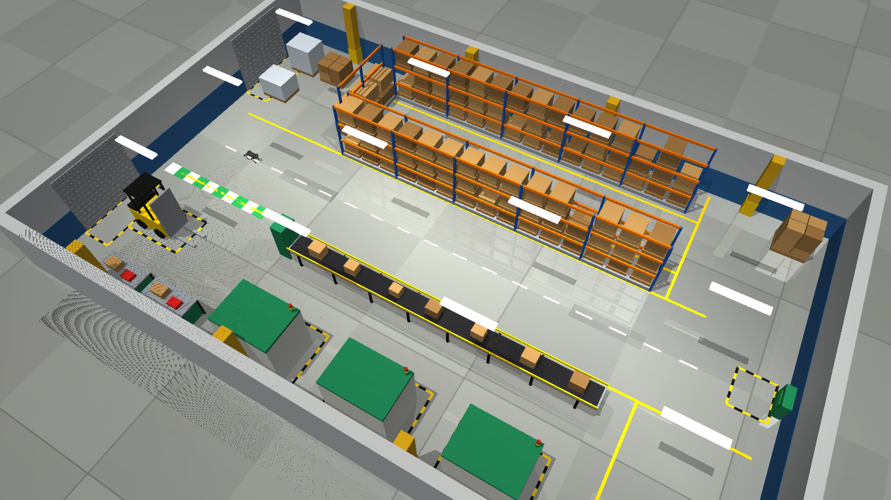

# Unitree Go1 autonomous navigation (ROS 2 Jazzy / MuJoCo)

The active robot in this workspace is **Unitree Go1**. Locomotion reuses the provided MuJoCo policy weights and observation normalizer; Nav2, AMCL, the workshop runtime watchdog, and RViz provide navigation, localization, safety, and visualization.

The default scene is a **factory hall** (24 m × 15 m): pallet racking with a picking aisle, a conveyor line, three machining cells, a forklift, loading doors, and painted aisle markings. The MuJoCo scene and the Nav2 map are generated from the same collision geometry. The earlier S-shaped maze is still available with `world:=maze`. Go2/CHAMP/ANYmal sources remain only as disabled upstream reference material.



## Build and run

One-time setup:

```bash
cd /home/ubuntu/ros2_ws
python3 -m venv --system-site-packages .venv
.venv/bin/python -m pip install 'mujoco>=3.0'
source scripts/env.sh
colcon build --symlink-install
```

Start the demo:

```bash
./scripts/start_demo.sh
```

The MuJoCo window opens with a camera following Go1, and RViz shows the map, laser, costmaps, and planned path. About 30 s after start, Go1 automatically walks from `(0, 0)` along the main aisle, turns into the east cross aisle, and drives down the picking aisle to `(6, 4.5)`. On a headless test run it reached the goal in about 37 s. Nav2 caps forward speed at `0.8 m/s` (the policy tracks 0.3–1.0 m/s reliably and has a dead zone below 0.3 m/s).

Useful launch options:

```bash
# Use the RViz "Nav2 Goal" tool to choose goals manually
./scripts/start_demo.sh auto_goal:=false
# Change the automatic target (map frame, yaw in radians)
./scripts/start_demo.sh goal_x:=18.5 goal_y:=-5 goal_yaw:=-1.57
# Previous S-shaped maze scene
./scripts/start_demo.sh world:=maze
# Run Nav2 headless
./scripts/start_demo.sh mujoco_viewer:=false rviz:=false
```

Keep the launch terminal open; stop the full stack with Ctrl+C. In other terminals, source `scripts/env.sh` before ROS commands. The demo uses ROS domain 73 and localhost DDS discovery.

Good free goals in the factory: main aisle `(10, 0)`, east cross aisle `(18.5, 4.5)` / `(18.5, -5)`, picking aisle `(6…15, 4.5)`, start area `(0, 1)`.

## Mission and safety interfaces

```bash
source /home/ubuntu/ros2_ws/scripts/env.sh
ros2 run workshop_navigation goal.py 18.5 -5 --yaw -1.57 --timeout 300
ros2 topic echo /workshop/status
ros2 topic echo /workshop/mission
ros2 service call /workshop/emergency_stop std_srvs/srv/SetBool '{data: true}'
ros2 service call /workshop/emergency_stop std_srvs/srv/SetBool '{data: false}'
```

Nav2 publishes standard `/navigate_to_pose` actions and sends velocity through the velocity smoother, collision monitor, and command watchdog before the Go1 policy. MuJoCo publishes `/odom`, `/scan`, and `/joint_states`.

`lifecycle_guard.py` starts with Nav2. With Fast DDS a lifecycle service reply is occasionally lost at startup, which used to leave AMCL inactive (no `map → odom`, robot never moves). After a 20 s grace period the guard drives any stalled Nav2 node to active; on a healthy start it just logs `Nav2 bringup healthy` and exits.

## Regenerating the scenes and maps

The supplied `go1_corridor.mjb` is a compiled binary, so `build_go1_factory.py` rebuilds the Go1 robot into an editable `MjSpec` and adds the factory around it. Before saving, it checks that every robot body, joint, actuator, and contact parameter matches the supplied model, and runs the trained policy in both models (trajectory drift must be zero). Obstacles live in geom group 0 (seen by the laser and the map); floor markings and lamps live in group 1.

```bash
source scripts/env.sh
.venv/bin/python go1_mujoco_locomotion/scripts/build_go1_factory.py
.venv/bin/python src/workshop_navigation/scripts/generate_go1_factory_map.py
colcon build --symlink-install --packages-select go1_mujoco_locomotion workshop_navigation
```

The maze equivalents are `build_go1_maze.py` and `generate_go1_maze_map.py`.

## Reused components

- Go1 model, trained-policy files, and locomotion interface: `go1_mujoco_locomotion/`.
- Nav2 Jazzy bringup, AMCL, DWB, velocity smoother, and collision monitor: installed ROS packages.
- Workshop watchdog, emergency-stop service, goal/status helpers, lifecycle guard, and RViz config: `src/workshop_navigation/`.
- Unitree Go2 and ANYmal packages are retained in `src/` for attribution/reference but marked `COLCON_IGNORE`. The local CHAMP checkout (`src/champ`, upstream https://github.com/chvmp/champ) is not tracked by this repository.
- Run evidence: `docs/evidence/go1_factory_navigation.txt` (Go1 factory). Files named `go2_*` and `previous_anymal/` record earlier, now-inactive setups.
